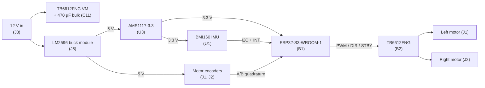

# Self-Balancing Robot Controller PCB

A two-layer controller board for a two-wheeled self-balancing robot, designed in Altium Designer. It combines an ESP32-S3 for control and wireless, a 6-axis IMU for tilt sensing, a dual H-bridge for two encoder motors, and the full power tree from a single 12 V input.

**Status:** Rev A — [fabricated and brought up]

## Block diagram



## Hardware overview

| Function | Part | Notes |
|---|---|---|
| MCU | ESP32-S3-WROOM-1 (B1) | Dual-core, Wi-Fi + BLE; RC reset circuit (10 kΩ / 1 µF) and BOOT/RESET buttons |
| IMU | Bosch BMI160 (U1) | Accelerometer + gyroscope over I2C, 4.7 kΩ pull-ups, interrupt line to MCU |
| Motor driver | Toshiba TB6612FNG (B2) | Dual H-bridge, paralleled output pins per channel, local 0.1 µF + 470 µF decoupling |
| 5 V rail | LM2596 buck module (J5) | Steps 12 V down to 5 V |
| 3.3 V rail | AMS1117-3.3 (U3) | 10 µF + 0.1 µF on input and output |
| Connectors | J1/J2 motors (6-pin), J3 12 V input, J4 UART, J5 buck module | |

## Design highlights

### The buck converter is a plug-in module
The 12 V → 5 V switching regulator is a pre-built LM2596 module on a header rather than a discrete layout. Its hot switching loop, inductor, and feedback network sit off the board, which takes the highest-risk part of a first-spin layout out of the picture. A bad regulator layout can't brick the board, and the module can be swapped or bypassed during bring-up.

### Motors stay off while the MCU boots
STBY on the TB6612FNG has an internal pull-down. While the ESP32's GPIOs float during reset and boot, the driver stays in standby, so the robot can't twitch its wheels on power-up. That safe-by-default state comes from the driver itself, so no extra parts are needed.

### Noisy and quiet sections are separated
The power entry, buck module, motor driver, and motor connectors sit along the bottom and right of the board. The MCU and IMU sit in the top and center, away from the motor current loop. The IMU is centered on the board, close to the robot's balance axis.

---

## Rev B changes

A post-layout design review turned up the following. Items are ordered by severity.

### Critical
- **Reset button (S1) wiring.** The B3F symbol for S1 is rotated relative to S2, and EN and GND each connect to both internal contact pairs of the switch. That can tie EN to GND permanently. Rev B will wire S1 like S2, with one pin from each internal pair.
- **IMU interrupt on a strapping pin.** IMU_INT is on IO45, which sets the flash voltage at reset. If the BMI160 holds INT1 high during a warm reset (button, watchdog, brownout), the module boots with the wrong flash voltage. Rev B will move IMU_INT to a non-strapping GPIO.
- **Copper under the antenna.** Pour on both layers extends under the WROOM-1 antenna. Rev B will move the module so the antenna sits at the board edge, with a copper keepout on all layers.

### Electrical
- **Encoder logic levels.** The encoders are powered from 5 V and drive 3.3 V GPIOs directly. Rev B will power them from 3.3 V or add level shifting.
- **TB6612 logic supply.** Rev B will confirm VCC is tied to 3.3 V so the input thresholds match the ESP32's output levels.
- **Reverse-polarity protection.** Rev B will add a P-FET reverse-polarity circuit, a fuse, and a power switch on the 12 V input.
- **VM headroom.** The TB6612's VM is rated to 15 V absolute maximum. Rev B will add a TVS diode on VM and confirm C11 is rated 25 V or higher.
- **BMI160 strapping.** Rev B will confirm SDO is tied to set a fixed I2C address and that OCSB/OSDO are handled per the datasheet.

### Layout
- **Power trace widths.** Rev B will widen the 12 V, VM, and motor output traces to 0.5–1 mm and use multiple vias where motor current changes layers.
- **Ground stitching.** Rev B will add stitching vias along the signal bus and board perimeter so the two ground pours act as one plane, and will remove dead copper.
- **LDO heat.** Rev B will add copper area on the AMS1117 tab.
- **Connector keying.** J4 (UART) and J5 (buck module) are identical 1×4 headers side by side. Rev B will use different connectors so a UART cable can't land on the power header.
- **Buck module footprint.** Rev B will match the footprint to the LM2596 module's actual pad positions and reserve its outline on the board.

### Features
- Battery voltage sensing through a divider on an ADC pin, so motor PWM can compensate as the battery sags.
- Native USB-C on IO19/IO20 for flashing and debugging, replacing the external UART adapter.
- Power LED and test points for 12 V, 5 V, 3.3 V, and GND.
- Silkscreen pin labels on every connector, board name and revision, and a filled-in schematic title block.

---

## Repository layout

```
├── README.md
├── docs/     schematic PDF, PCB images, 3D render
├── altium/   Altium project (.PrjPcb, .SchDoc, .PcbDoc)
```

## Author
Minh Nguyen — Computer Systems Engineering, University of Georgia